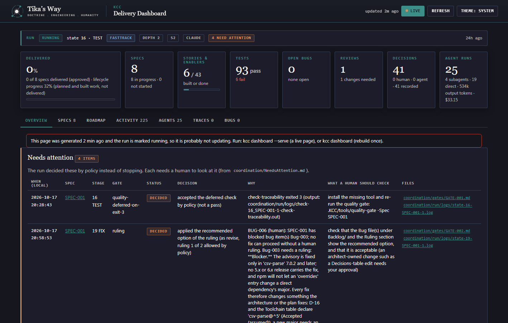
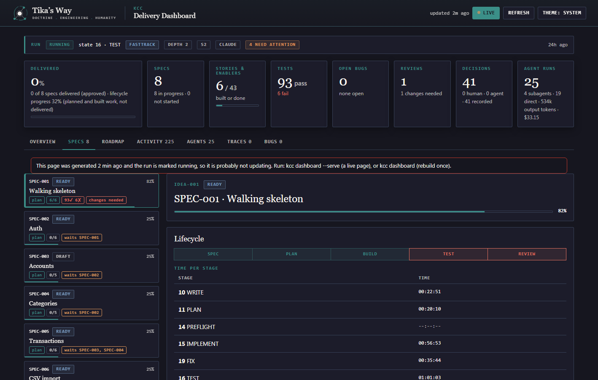
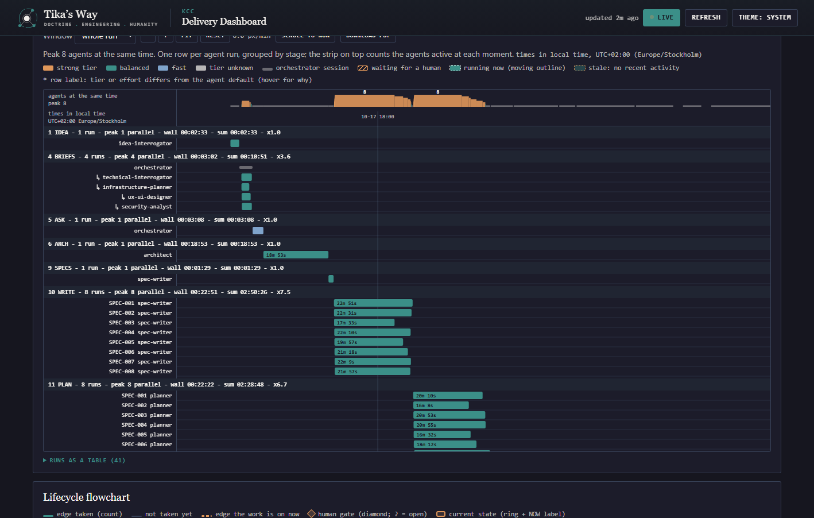

# Operating an unattended run

An unattended run is `--silent --assume`: nobody answers a prompt, so the
driver never waits. Every gate is answered by a policy, the answer is written
down, and a spec that cannot go on is parked while the other specs finish.
This guide says how to start one, what it can end with, where each outcome
is written, and what you do afterwards. It applies to every harness (Claude
Code, Codex, OpenCode, Ollama behind OpenCode, a generic command line): the
driver, the gates, the files and the exit codes are the same.

## Start one

From a terminal, in the project folder:

```text
kcc run --input "build a CLI that converts CSV to JSON" --fasttrack --silent --assume
kcc run --input ideas/ops-automation.md --silent --assume --budget 150 --currency USD
kcc run --input SPEC-003 --silent --assume
```

The same in a chat session of your harness:

```text
auto build a CLI that converts CSV to JSON --fasttrack --silent --assume
```

With the bare driver (no `kcc` binary):

```powershell
powershell -ExecutionPolicy Bypass -File .KCC\tools\kcc-run.ps1 -Input "build a CLI that converts CSV to JSON" -Fasttrack -Silent -Assume
```

```bash
bash .KCC/tools/kcc-run.sh --input "build a CLI that converts CSV to JSON" --fasttrack --silent --assume
```

`--silent` and `--assume` go together; giving one without the other is a
usage error (exit 2). Add `--open-dashboard` to open `dashboard/index.html`
once the run starts, or run `kcc dashboard --serve` in a second terminal. The
page is rebuilt from the files on every request, so it shows a stale or dead
run as such.



The run ends with one of these exit codes:

| Exit code | Meaning |
|--|--|
| 0 | Every spec closed; `coordination/NeedsAttention.md` holds only `decided` items, or none |
| 2 | Usage or environment error before anything ran (bad arguments, missing harness template) |
| 5 | Suspended on a usage limit; `kcc run` waits and resumes by itself, the bare driver arms `kcc-limit-watch` |
| 6 | Stopped or aborted; the reason is in `coordination/run/run.json` and the `session-closed` event |
| 7 | Every spec that could finish did; at least one `[open]` item in `coordination/NeedsAttention.md` needs you |

An unattended run never exits 4 (paused at a gate).

## How a run can end

Each spec ends in one of the states below. The first three are review
verdicts the verifier writes into `review.md`; only `APPROVED` is a pass.

| Outcome | What you see on the dashboard | Where it is written | What to do |
|--|--|--|--|
| `APPROVED` | The spec card ends green; the stage table shows TEST and REVIEW done | `review.md` (verdict, Evidence block), `closed.md`, `review-produced` and `spec-reviewed` events in `coordination/backchannel.jsonl` | Nothing. `/spec-merge SPEC-NNN` drafts the pull request when you want it |
| `QUALITY_DEFERRED` | An amber verdict state, like a deferred stage; Needs attention lists a `decided` item with gate `quality-deferred-on-exit-3` | `review.md` (the deferred rows and the missing tool), `closed.md` (`DEFERRED, NOT A PASS - SPEC-NNN: ...`), `NeedsAttention.md`, `deferral-accepted` event | Install the scanner the item names (the install command comes from `toolchain-preflight`), then re-run the gate: `kcc tool quality-gate --spec SPEC-NNN`. Exit 0 is the pass the review could not give |
| `WAIVER_NEEDED` | An amber verdict state; Needs attention lists a `decided` item with gate `waiver` and the gate items | `review.md -> ## Waivers` (Item, Why it is not a code fix, What a human does), `closed.md` (`WAIVER NEEDED, NOT A PASS - SPEC-NNN: ...`), `NeedsAttention.md`, `deferral-accepted` event with verdict `WAIVER_NEEDED` and gate `waiver` | Read the Waivers table. Either fix the environment and re-verify (`recheck`, below) or accept the waiver as a recorded decision. No implementer run will change it |
| A blocked Bug ruled by policy | Needs attention lists a `decided` item with gate `ruling`; the Bug chip on the spec card | The Bug file (`Backlog/Bug-NNN.md`): `## Ruling needed` with the options, `## Ruling` with the policy answer; `NeedsAttention.md`; `human-gate-decision` event with `answered_by: policy` | Check that the recommended option the run applied is the one you would have chosen. If not, set the Bug back to `Status: open`, write your decision under `## Ruling`, and re-run FIX for that spec (below) |
| A parked spec | The lane is `needs-attention`; specs that depend on it say `waits SPEC-NNN`; Needs attention lists an `[open]` item | `NeedsAttention.md` (`why:` the violations, `todo:` the exact command), `coordination/lanes.json`, the gate file under `coordination/gates/`, the state log the item links | Fix the cause the item names, then `kcc run --resume`. The run exits 7 until the item is closed |
| A merge conflict | The lane is `failed` and names the files; specs that depend on it wait | `NeedsAttention.md` (`todo:` the exact commands); the branch `spec/SPEC-NNN` holds the lane's work, its review and its test results until it is merged | `git merge spec/SPEC-NNN`, resolve every conflict marker (a commit that still contains `<<<<<<<` is not a resolution), commit, then `kcc run --resume`. A run that already closed reopens for that lane |
| A usage-limit suspension | The run shows as suspended with the reset time; nothing is "running" | `coordination/run/run.json`, a restore point under `coordination/checkpoints/`, `kcc limits` | Nothing when `kcc run` started it: it waits for the reset and resumes. With the bare driver, `kcc-limit-watch` was armed; `kcc limits` shows the time, `kcc run --resume` continues by hand |



### APPROVED

The spec passed traceability, the quality gate, and every acceptance
criterion and Test ID, with no open blocker or major Bug. Nothing is waiting
for you. The commands to push the branch and open the pull request come from
`/spec-merge SPEC-NNN`, which never pushes by itself.

### QUALITY_DEFERRED: a scanner is missing

`quality-gate` exited 3 because a scanner could not run (semgrep or opengrep,
osv-scanner, gitleaks, trivy), and everything else was verified. The run does
not loop on this: the review closes the spec as deferred-accepted and the lane
ends. The spec is not approved until the gate passes with the scanner present.

```text
kcc tool toolchain-preflight --tools semgrep      # prints the install command for this OS; installs nothing
kcc tool quality-gate --spec SPEC-003              # exit 0 = the gate passes now
```

### WAIVER_NEEDED: fix the environment or waive

Every Bug is closed and what keeps the gate red is outside the code: a gate
tool error, a built image older than the workspace, an environment limit (a
registry the build cannot reach, a test the operating system cannot run), or a
check the architecture excluded. `review.md` carries a `## Waivers` table:

```text
| Item | Why it is not a code fix | What a human does |
|--|--|--|
| QG-IMAGE image-scan-built (api) | a RUN step cannot reach the registry over TLS on this host (LIMIT docker-build-network) | trust the proxy certificate in Docker (KCC_CA_BUNDLE) or verify on another host, then recheck |
```

The review verdict is not a pass, and the implementer is not sent back,
because no code change turns the item green. The `waiver` gate has three
answers:

| Answer | Effect |
|--|--|
| `waive` | The spec closes as `WAIVER_NEEDED`. Recorded as a `deferral-accepted` event (verdict `WAIVER_NEEDED`, gate `waiver`); the run goes on. This is the policy answer under `--silent --assume` |
| `recheck` | You changed the environment. TEST runs again for that spec, scoped: only the deferred checks, the mechanical gates and anything that changed |
| `abort` | The run stops (exit 6) |

Unattended, the run already answered `waive`, so the `decided` item in
`NeedsAttention.md` lists the gate items and the command that re-runs the
verification. After you fixed the environment, re-run TEST for that spec from
state 16:

```text
kcc run --lane SPEC-003 --from 16
kcc run --resume
```

```powershell
powershell -ExecutionPolicy Bypass -File .KCC\tools\kcc-run.ps1 -Input SPEC-003 -From 16
```

```bash
bash .KCC/tools/kcc-run.sh --input SPEC-003 --from 16
```

A run started without `--silent --assume` pauses at the gate instead (exit
4) and you answer it:

```text
kcc run --lane SPEC-003 --answer recheck     # after the fix
kcc run --lane SPEC-003 --answer waive       # accept the waiver and go on
kcc run --resume
```

The same answers work on the bare driver (`kcc-run -Answer recheck`,
`bash .KCC/tools/kcc-run.sh --answer waive`). When you only want to see
whether the gate is green now, run it alone:
`kcc tool quality-gate --spec SPEC-003`.

The dashboard shows `WAIVER_NEEDED` as its own verdict state, amber, like a
deferred one. A `CHANGES_NEEDED` review with no open Bug, no failing gate check
that an implementer owns and no traceability error is read the same way: the
exit check reports `REVIEW-004 (human)` and the `waiver` gate opens, so the
implementer is no longer dispatched for a fix it cannot make.

### A blocked Bug ruled by policy

A Bug with `Status: blocked` needs a decision the implementer may not make
alone (for example, amend a Decisions table entry or change a declared
dependency). The Bug file has a `## Ruling needed` section with the options
and a recommended one. Unattended, the policy answer is `revise` with the
recommended option, at most twice per spec; after that the spec is parked.
The applied ruling is under `## Ruling` in the Bug file and as a `decided`
item (gate `ruling`) in `NeedsAttention.md`.

Check the ruling. If you disagree, set the Bug back to `Status: open`, write
your decision under `## Ruling`, and re-run FIX (state 19) for the spec:

```text
kcc run --lane SPEC-003 --from 19
kcc run --resume
```

### A parked spec

A spec is parked when no policy can answer: three failed exit checks or a
third full verifier pass (the `loop` gate), an estimate over `--budget` (the
`budget-cap` gate), an exit check that returned 2, or a plan without
`## Waves`. The item is `[open]` in `NeedsAttention.md`:

```text
## [open] SPEC-002 | loop | state 16 TEST | 2026-10-17T12:00:00Z

- why: the violations or the situation that caused it
- todo: fix the cause, then: kcc run --lane SPEC-002 --from 16 ; kcc run --resume
- links: coordination/gates/GATE-004.md, coordination/run/logs/state-16-SPEC-002-3.log
```

The other specs finish, the run closes and exits 7. Read the linked log and
gate file, fix the cause, then run the `todo:` command. The attempts of the
parked unit were reset, so the retry starts fresh.

### A usage-limit suspension

When the harness prints its usage-limit notice, the run is suspended (exit
5), a restore point is written, and the reset time is read from the output.
`kcc run` waits and resumes the same run by itself, up to
`continuity.max_resumes` times. The bare driver arms `kcc-limit-watch`
instead, which does the same from a detached process. `kcc limits` shows the
last limit and the next resume; `kcc run --resume` continues at once if the
limit has already reset. A notice in the middle of an agent's text does not
count: only a notice on the last lines of the harness output does.



## Machines behind a TLS-intercepting proxy or antivirus

Some limits are not a missing tool: the tool is there and still cannot do its
job on this machine. When `docker` is a required tool and present, PREFLIGHT
runs two probes and prints one line each:

```text
LIMIT docker-daemon unreachable: docker is installed but its daemon is not running (start Docker Desktop or the docker service); image pulls, builds and compose up will fail until it is
PROBE    docker-registry reachable (docker pull hello-world)
LIMIT docker-build-network unreachable: a RUN step inside a build cannot reach registries over TLS (exit 1: ...); npm ci / pip install / apk inside docker build and compose up --build will fail on this machine (a proxy or antivirus intercepts TLS; see KCC_CA_BUNDLE)
```

The first probe is `docker pull hello-world` through the daemon. The second is
a one-line `docker build` whose `RUN` step opens a TLS connection to a package
registry. Docker Desktop behind a proxy or an antivirus that inspects HTTPS
passes the first and fails the second: the daemon pulls, but the build
containers do not trust the interceptor's certificate, so `npm ci`,
`pip install` and `apk` inside a build fail.

A `LIMIT` line never fails the preflight and never opens the install gate.
The driver copies the lines into the TEST prompt as `KNOWN ENVIRONMENT
LIMITS`, and the verifier records the checks they rule out as `DEFERRED` with
that reason at once instead of after a long build attempt. The review then
ends `WAIVER_NEEDED` (or `QUALITY_DEFERRED`), not `CHANGES_NEEDED`. The fix is
yours, and there are three:

| Fix | How |
|--|--|
| Trust the proxy's root certificate inside Docker | Export the certificate as a PEM file and set `KCC_CA_BUNDLE` to its path (on Windows, a user environment variable is read too). The gate mounts the file into the containers it starts and sets `SSL_CERT_FILE`, `REQUESTS_CA_BUNDLE` and `CURL_CA_BUNDLE`; your own Dockerfiles need the same certificate in their `RUN` steps |
| Switch HTTPS inspection off for Docker | In the proxy or antivirus console, exclude the Docker Desktop processes or the registry hosts (`registry.npmjs.org`, `pypi.org`, `dl-cdn.alpinelinux.org`, your image registry) |
| Verify on another host | Run the TEST state on a machine without the interceptor: `kcc run --lane SPEC-003 --from 16` there, or answer `recheck` from there. CI runners usually qualify |

Then answer `recheck`, or re-run TEST from state 16 as shown above. Run the
probes alone with the preflight tool:

```powershell
powershell -ExecutionPolicy Bypass -File .KCC\tools\toolchain-preflight.ps1 -Tools docker
```

```bash
bash .KCC/tools/toolchain-preflight.sh --tools docker
```

## Reading the quality gate report

`quality-gate` prints one row per check and exits 0 (pass), 1 (a failure the
code owns), 3 (deferred, never a pass) or 2 (usage error). `--json` gives the
same rows as `{ id, severity, fix_owner, file, message }`.

```text
kcc tool quality-gate --spec SPEC-003
kcc tool quality-gate --spec SPEC-003 --json
```

What to look at:

- **`QG-SCOPE`.** The first row says where the scope came from: the plan's
  `## Gates coverage` table (the architect decides the gates, the planner maps
  them; `check-run-conformance` enforces the table as PLAN-007). The checks the
  plan does not cover are listed in this row as out of scope, not failed.
  `--scope <name>` overrides it; a plan without the table means scope `all`.
- **`deferred` is not `fail`.** A `fail` row names an implementer-owned
  problem and sends the spec to FIX. A `deferred` row means the check could
  not run: a scanner that exited without a result, a gate tool error, a stale
  image. The owner of the row says who acts.
- **Owners (`fix_owner`).** `implementer` and `infrastructure-implementer`
  rows are fixed by the run. `human` rows need you (install a scanner, fix the
  environment, decide a waiver). `architect` rows are about what the gate was
  asked to run (the scope row, an excluded check).
- **Dependency advisories (`QG-DEPS`).** The audit counts production
  dependency groups; dev-only advisories are named in the message and do not
  gate unless `quality.audit_dev_dependencies` is `true`. osv-scanner is
  called per lockfile (`-L`), or per directory only when there is no lockfile.
  When osv-scanner cannot run, the per-stack audit (`npm audit`, `pip-audit`,
  `dotnet list package --vulnerable`) stands in. For the verifier a finding is
  a Bug only when it is at or above `quality.fail_on.dependencies`, in a
  production dependency, and in a package the spec imports or a direct
  dependency the spec added; everything else is an observation with a
  follow-up line.
- **Stale images (`QG-IMAGE`).** A built image older than any workspace file
  is not scanned; the row is `deferred` with a rebuild hint (`docker compose
  build`, then re-run the gate). Scanning an image from an earlier run would
  say nothing about the code under review.
- **SAST (`QG-SAST`).** `quality.scanners.sast` is `semgrep` (default) or
  `opengrep`; when the named one is missing the other stands in.
  `quality.sast_rules` (default `auto`, the registry) names the rules;
  opengrep has no registry, so it needs a local rules folder
  (`architecture/sast-rules/`) or the check is deferred.
- **`--require`** turns every deferred scanner into a failure. Use it in CI,
  where a missing scanner is a pipeline fault, not on a developer machine.

## What a human never has to do

- Re-run FIX by hand after a review. A failing review goes to FIX by itself; a
  FIX with no open Bug and no implementer-owned violation is skipped.
- Edit the gate tool, the plan's scope or the review to make a red item green.
  A red item outside the code is a waiver or a deferral with an owner, never a
  reason to change the gate.
- Wait for a loop to time out. A gate no code change can turn green opens the
  `waiver` gate at once; a scoped TEST with nothing to verify is not
  dispatched (`test-skipped`); a blocked Bug opens the `ruling` gate before
  the implementer runs.
- Answer the same question twice. Every policy answer is a `decided` item
  with the decision and the command that re-runs the step.
- Watch the terminal. The dashboard, `NeedsAttention.md`, `closed.md` and the
  exit code carry the same facts.

## Related

- [How to use KCC](./how-to-use-kcc.md): the operating scenarios
- [The kcc command line](./cli.md): `kcc run`, its options and exit codes
- [KCC tools reference](./kcc-tools-reference.md): `quality-gate`, `toolchain-preflight`, `kcc-run`
- `.KCC/kernel/protocols/kcc-run.md`: the driver protocol (gates, policy answers, `NeedsAttention.md`)
- `.KCC/kernel/protocols/toolchain-preflight.md`: the environment probes
- `.KCC/kernel/protocols/architecture-governance.md`: the quality gate catalog

---

KCC framework (c) 2026 Tarek Fawaz, [tikasway.dev](https://tikasway.dev/kcc). Licensed under the terms in [LICENSE](../LICENSE).
